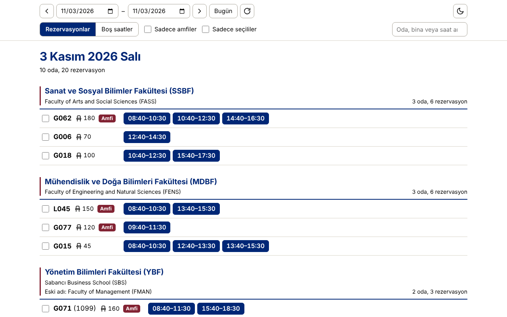
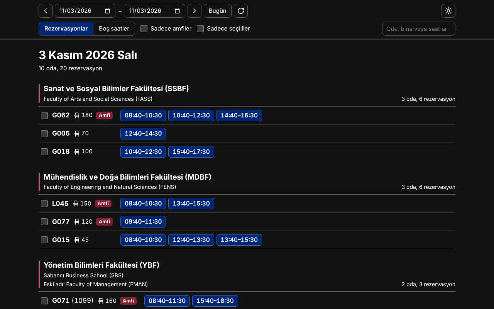
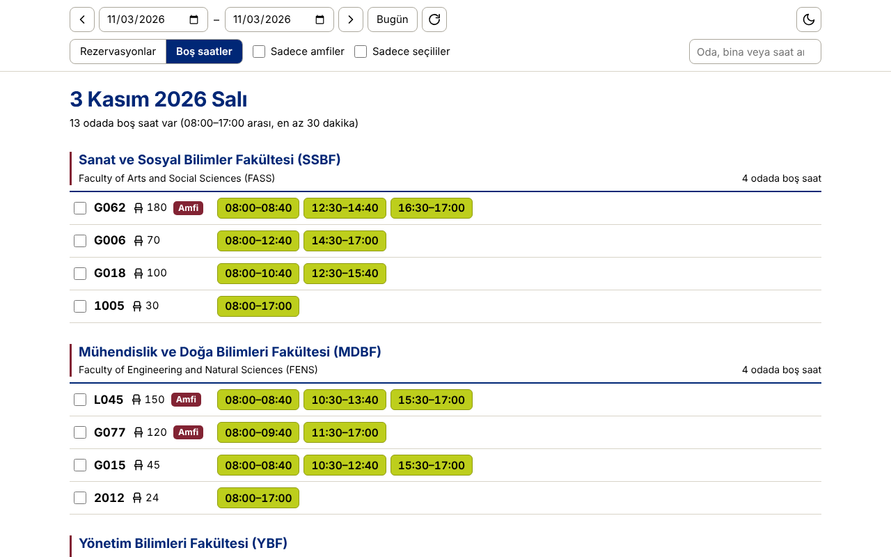
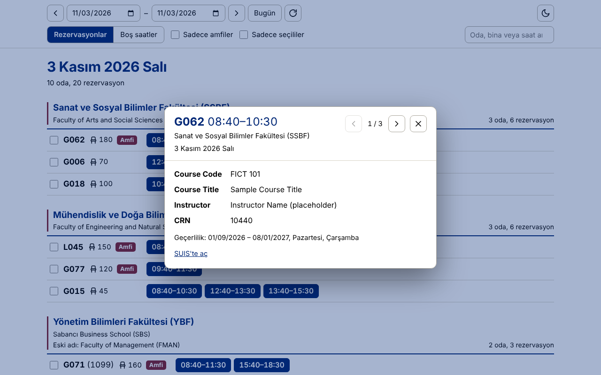

<h1 align="center">SU Room Reservation</h1>

<b>Room reservations and free hours at Sabancı University, in one view.</b>

🇬🇧 English · <a href="README.tr.md">🇹🇷 Türkçe</a>

  
  
  
  
  

> [!IMPORTANT]
> **Unofficial project.** SU Room Reservation is an independent, community-made tool. It is **not affiliated with, endorsed by, or sponsored by Sabancı University**. "Sabancı University", "SUIS" and related names and logos belong to their respective owners. Data is read from SUIS's public room search page. If you represent the university and have concerns, please [open an issue](../../issues).

Instead of opening the buildings one by one on the SUIS Room Search page, this tool lists the reservations of all buildings in a single **building › room › time** view. It is read-only: it does not make or change reservations.

| Light | Dark |
|---|---|
|  |  |

*Screenshots use placeholder data; no personal information is shown.*

## Features

- **Reservations / Free hours:** shows booked slots, or the free time between 08:00 and 17:00.
- **Detail:** tap a slot to see course code, title, CRN and instructor; use the arrows to move through the room's other reservations.
- **Filters:** amphitheatres only, selected rooms only, and search (room, building, time).
- **Navigation:** previous/next day with the keyboard (`←` `→`) or by swiping on a phone.
- **Dark and light theme;** your choices are remembered on your device.
- **Update notice** in the Android app when a new version is available.

| Free hours | Slot detail |
|---|---|
|  |  |

## Installation

| | |
|---|---|
| **Android app** | [Latest release page](../../releases/latest) → `SU-Room-Reservation-….apk` |
| **Edge / Chrome extension** | [su-oda-ozeti-eklenti.zip](../../releases/latest/download/su-oda-ozeti-eklenti.zip) |
| **Bookmarklet (no install)** | [su-oda-ozeti-kurulum.html](../../releases/latest/download/su-oda-ozeti-kurulum.html) |

### Android

1. Open the [latest release page](../../releases/latest) on your phone, download the `.apk` and open it.
2. If asked, allow your browser to **install unknown apps**.
3. Play Protect may warn about an "unrecognized developer" → **Install anyway**.

The app appears as **SU Rooms** on your home screen. When a new version is out, the app tells you on launch; tap **İndir ve kur** (download and install).

### Edge / Chrome extension (desktop)

Clicking its icon opens the overview in a new tab.

1. Download the [extension zip](../../releases/latest/download/su-oda-ozeti-eklenti.zip) and extract it to a **permanent folder** (for example `Documents\su-oda-ozeti`). The extension runs from that folder; do not delete or move it.
2. Go to `edge://extensions` (`chrome://extensions` in Chrome).
3. Turn on **Developer mode** → **Load unpacked** → select the folder.
4. Pin **SU Oda Özeti** to the toolbar from the puzzle-piece menu.

**Updating:** extract the new zip over the same folder, then press the reload (↻) button on the extensions page.

### Bookmarklet (no install)

1. Download the [setup page](../../releases/latest/download/su-oda-ozeti-kurulum.html) and open it in your browser.
2. Drag the **SU Oda Özeti** button onto your bookmarks bar (`Ctrl+Shift+B` shows the bar).
3. On the SUIS Room Search page, click the bookmark.

## Usage tips

- **Changing the day:** `←` `→` on desktop; the arrows at the bottom on a phone.
- **Detail window:** `←` `→` on desktop, or swipe left/right on a phone, to move to the room's previous/next reservation. `Esc`, pulling down, or the back button closes it.
- **Choosing rooms:** tick the box at the left of a room, then use **Sadece seçililer** (selected only) to see just those.
- **Free hours:** between 08:00 and 17:00; gaps shorter than 30 minutes are not shown.

## Privacy and permissions

No personal data is collected, stored, transmitted or sold. There are no accounts, analytics, ads or tracking. The software connects only to `suis.sabanciuniv.edu` to read public room schedules and, in the Android app, to `github.com` to check for a newer version. Your preferences stay on your device.

The extension asks for host access to `suis.sabanciuniv.edu` and the `declarativeNetRequestWithHostAccess` permission; both are explained in [PRIVACY.md](PRIVACY.md).

## How it works

- For the chosen date range, it requests the public SUIS room search pages (one request per building) and reads the HTML locally.
- When you open a slot, it fetches that room's schedule for the day and the CRN detail page from SUIS.
- Free hours are computed on your device: 08:00–17:00 minus the reservations, hiding gaps under 30 minutes.
- The SUIS server rejects requests from other origins. The extension therefore uses `declarativeNetRequest` to set the `Origin` and `Referer` headers, only on its own requests to `suis.sabanciuniv.edu`. The Android app sends its requests from the app itself. The bookmarklet runs on the SUIS page, so it needs no workaround.
- There is no server of mine in between; nothing is sent anywhere except to SUIS (and GitHub for the Android update check).

## Known limitations

- It depends on the structure of the SUIS pages. If SUIS changes them, the tool may stop working until it is updated.
- It shows only what SUIS publishes, and it cannot make reservations.
- Free hours cover 08:00–17:00 only, and gaps under 30 minutes are hidden.
- The Android app is installed from an APK outside the Play Store, so Android and Play Protect show warnings. There is no iOS version.
- The extension is installed manually (Developer mode) and updated manually.
- The bookmarklet only works on the SUIS Room Search page.

## Development

The source code is maintained in a separate private repository; this repository hosts the releases, the documentation and the [issue tracker](../../issues). Release files are built from that repository by CI.

## Contributing

Bug reports and suggestions are welcome through [issues](../../issues/new/choose). Please blur or remove personal information from screenshots and logs before attaching them. Since the source is not in this repository, pull requests are only expected for documentation fixes.

## License

[MIT](LICENSE) © 2026 malibay96. The license covers only this project. It grants no rights to Sabancı University's software, content, names or marks, and the project does not redistribute SUIS pages, styles or images.
