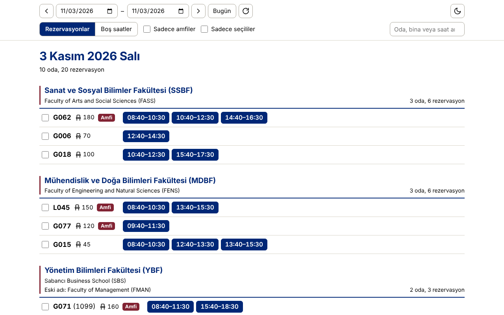
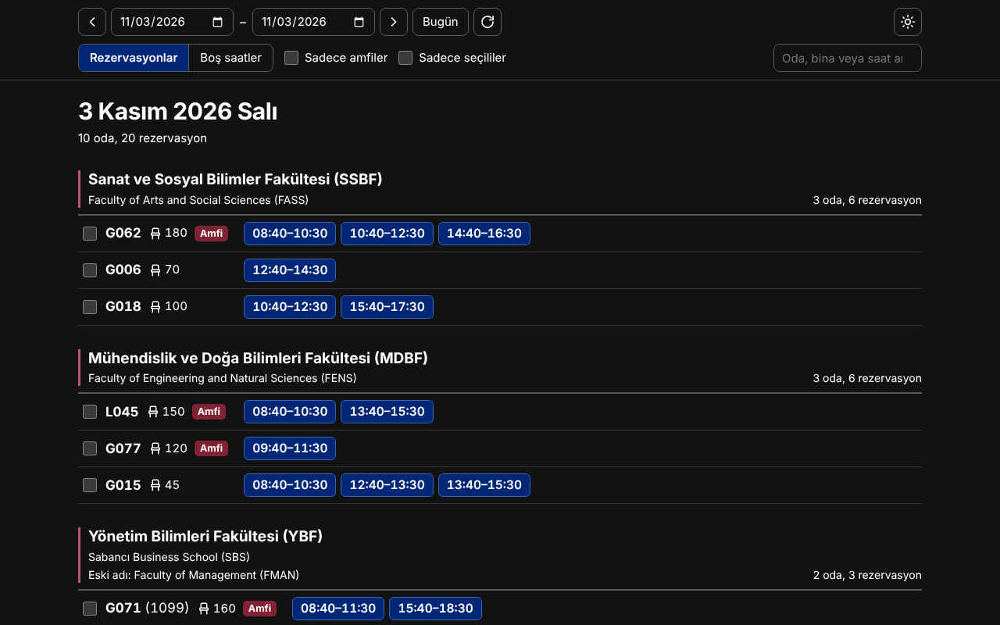
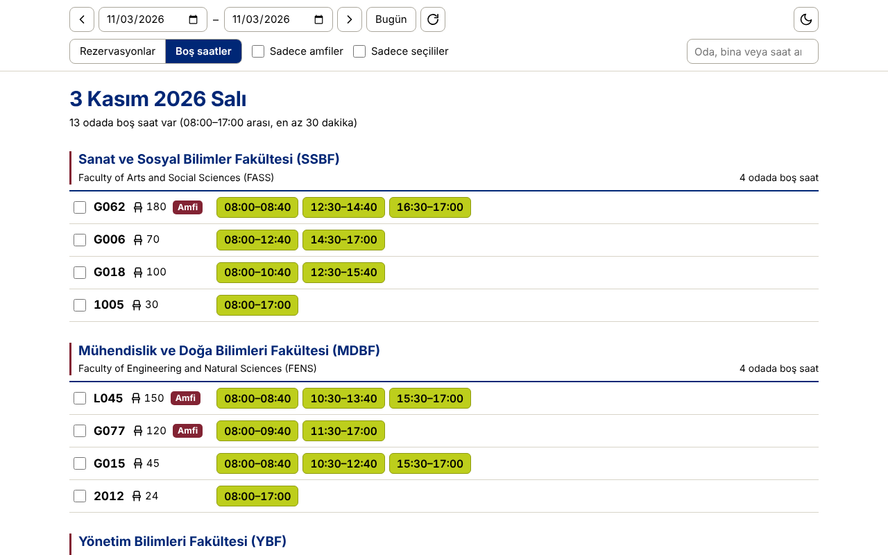
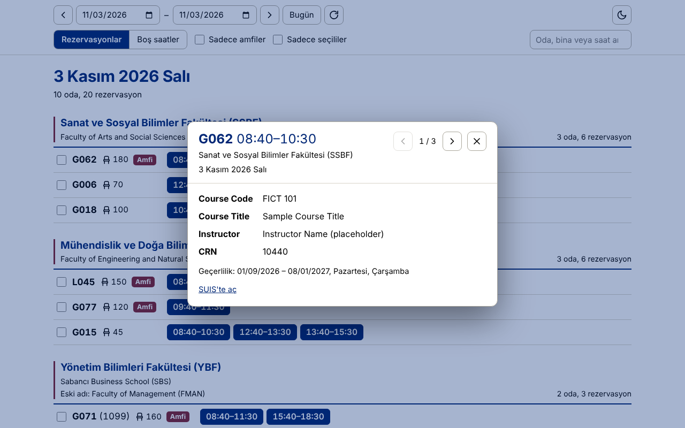

<h1 align="center">SU Room Reservation</h1>

<b>Sabancı Üniversitesi'ndeki oda rezervasyonlarını ve boş saatleri tek ekranda gösterir.</b>

<a href="README.md">🇬🇧 English</a> · 🇹🇷 Türkçe

  
  
  
  
  

> [!IMPORTANT]
> **Resmi olmayan proje.** SU Room Reservation bağımsız, topluluk tarafından yapılmış bir araçtır. **Sabancı Üniversitesi ile bağlantısı yoktur; üniversite tarafından onaylanmamış ve desteklenmemiştir.** "Sabancı Üniversitesi", "SUIS" ve ilgili ad ve logolar sahiplerine aittir. Veriler SUIS'in herkese açık oda arama sayfasından okunur. Üniversiteyi temsil ediyorsanız ve bir çekinceniz varsa lütfen [issue açın](../../issues).

SUIS'teki Room Search sayfasında binaları tek tek açmak yerine, tüm binaların rezervasyonları **bina › oda › saat** düzeninde tek listede görünür. Yalnızca görüntüler; rezervasyon yapmaz veya değiştirmez.

| Aydınlık | Karanlık |
|---|---|
|  |  |

*Ekran görüntülerinde yer tutucu veriler kullanılmıştır; kişisel bilgi içermez.*

## Özellikler

- **Rezervasyonlar / Boş saatler:** Dolu saatleri ya da 08:00–17:00 arasındaki boş zamanları gösterir.
- **Detay:** Saate dokununca ders kodu, adı, CRN ve öğretim üyesi açılır; oklarla aynı odanın diğer rezervasyonlarına geçilir.
- **Filtreler:** Sadece amfiler, sadece seçtiğin odalar, arama (oda, bina, saat).
- **Gezinme:** Önceki/sonraki gün klavyeyle (`←` `→`) ya da telefonda kaydırarak değişir.
- **Karanlık ve aydınlık tema;** seçimlerin cihazında hatırlanır.
- Android uygulamasında yeni sürüm çıkınca **güncelleme bildirimi**.

| Boş saatler | Rezervasyon detayı |
|---|---|
|  |  |

## Kurulum

| | |
|---|---|
| **Android uygulaması** | [Son sürüm sayfası](../../releases/latest) → `SU-Room-Reservation-….apk` |
| **Edge / Chrome eklentisi** | [su-oda-ozeti-eklenti.zip](../../releases/latest/download/su-oda-ozeti-eklenti.zip) |
| **Yer imi (kurulumsuz)** | [su-oda-ozeti-kurulum.html](../../releases/latest/download/su-oda-ozeti-kurulum.html) |

### Android

1. Telefonda [son sürüm sayfasını](../../releases/latest) aç, `.apk` dosyasını indir ve aç.
2. İzin isterse tarayıcına **bilinmeyen uygulamaları yükleme** izni ver.
3. Play Protect "tanınmayan geliştirici" uyarısı gösterebilir → **Yine de yükle**.

Ana ekranda **SU Rooms** adıyla görünür. Yeni sürüm çıktığında uygulama açılışta haber verir; **İndir ve kur** düğmesine dokunman yeterli.

### Edge / Chrome eklentisi (bilgisayar)

Simgesine tıklayınca özet doğrudan yeni sekmede açılır.

1. [Eklenti zip'ini](../../releases/latest/download/su-oda-ozeti-eklenti.zip) indir ve **kalıcı bir klasöre** çıkar (ör. `Belgeler\su-oda-ozeti`). Eklenti oradan çalışır; klasörü silme ya da taşıma.
2. Adres çubuğuna `edge://extensions` (Chrome'da `chrome://extensions`) yaz.
3. **Geliştirici modu** anahtarını aç → **Paketlenmemiş öğe yükle** (*Load unpacked*) → klasörü seç.
4. Yapboz simgesinden **SU Oda Özeti**'ni araç çubuğuna sabitle.

**Güncelleme:** yeni zip'i aynı klasöre çıkarıp üzerine yaz, eklentiler sayfasında yenile (↻) düğmesine bas.

### Yer imi (kurulum gerektirmez)

1. [Kurulum sayfasını](../../releases/latest/download/su-oda-ozeti-kurulum.html) indir ve tarayıcıda aç.
2. Sayfadaki **SU Oda Özeti** düğmesini yer imleri çubuğuna sürükle (çubuk görünmüyorsa `Ctrl+Shift+B`).
3. SUIS Room Search sayfasındayken yer imine tıkla.

## Kullanım ipuçları

- **Gün değiştirme:** Bilgisayarda `←` `→` tuşları, telefonda alttaki oklar.
- **Detay penceresi:** Bilgisayarda `←` `→` ile, telefonda sağa-sola kaydırarak aynı odanın önceki/sonraki rezervasyonuna geçilir. `Esc`, aşağı çekme ya da geri tuşu kapatır.
- **Oda seçme:** Odanın solundaki kutucuğu işaretle, sonra **Sadece seçililer** ile yalnızca onları gör.
- **Boş saatler:** 08:00–17:00 arası; 30 dakikadan kısa aralar gösterilmez.

## Gizlilik ve izinler

Hiçbir kişisel veri toplanmaz, saklanmaz, iletilmez veya satılmaz. Hesap, analitik, reklam ya da izleme yoktur. Yazılım yalnızca herkese açık oda programlarını okumak için `suis.sabanciuniv.edu` adresine, Android uygulamasında ayrıca yeni sürüm kontrolü için `github.com` adresine bağlanır. Tercihlerin cihazında kalır.

Eklenti `suis.sabanciuniv.edu` için ana makine erişimi ve `declarativeNetRequestWithHostAccess` izni ister; ikisinin gerekçesi [PRIVACY.md](PRIVACY.md) dosyasındadır.

## Nasıl çalışır

- Seçilen tarih aralığı için SUIS'in herkese açık oda arama sayfalarını (bina başına bir istek) ister ve HTML'i yerelde okur.
- Bir saate dokunduğunda, o odanın o günkü programını ve CRN detay sayfasını SUIS'ten getirir.
- Boş saatler cihazında hesaplanır: 08:00–17:00'dan rezervasyonlar çıkarılır, 30 dakikadan kısa aralar gizlenir.
- SUIS sunucusu başka kaynaklardan (Origin) gelen istekleri reddeder. Eklenti bu yüzden `declarativeNetRequest` ile `Origin` ve `Referer` başlıklarını ayarlar; yalnızca kendi `suis.sabanciuniv.edu` isteklerinde. Android uygulaması istekleri uygulamanın kendisinden gönderir. Yer imi SUIS sayfasında çalıştığı için ek bir işleme gerek yoktur.
- Arada benim bir sunucum yoktur; SUIS (ve Android güncelleme kontrolü için GitHub) dışında hiçbir yere veri gitmez.

## Bilinen sınırlamalar

- SUIS sayfalarının yapısına bağlıdır. SUIS bunları değiştirirse araç, güncellenene kadar çalışmayabilir.
- Yalnızca SUIS'in yayımladığını gösterir; rezervasyon yapamaz.
- Boş saatler yalnızca 08:00–17:00 arasını kapsar; 30 dakikadan kısa aralar gizlenir.
- Android uygulaması Play Store dışında APK ile kurulur; bu yüzden Android ve Play Protect uyarı gösterir. iOS sürümü yoktur.
- Eklenti elle (Geliştirici modu) kurulur ve elle güncellenir.
- Yer imi yalnızca SUIS Room Search sayfasında çalışır.

## Geliştirme

Kaynak kod ayrı, özel bir depoda tutulur; bu depo sürümleri, dokümantasyonu ve [issue takibini](../../issues) barındırır. Sürüm dosyaları o depodan CI ile üretilir.

## Katkı

Hata bildirimleri ve öneriler [issue](../../issues/new/choose) üzerinden memnuniyetle karşılanır. Ekran görüntüsü veya günlük eklemeden önce kişisel bilgileri bulanıklaştır ya da sil. Kaynak kod bu depoda olmadığı için pull request yalnızca dokümantasyon düzeltmeleri için beklenir.

## Lisans

[MIT](LICENSE) © 2026 malibay96. Lisans yalnızca bu projeyi kapsar. Sabancı Üniversitesi'nin yazılımı, içeriği, adı veya markaları üzerinde hak vermez; proje SUIS sayfalarını, stillerini veya görsellerini yeniden dağıtmaz.
